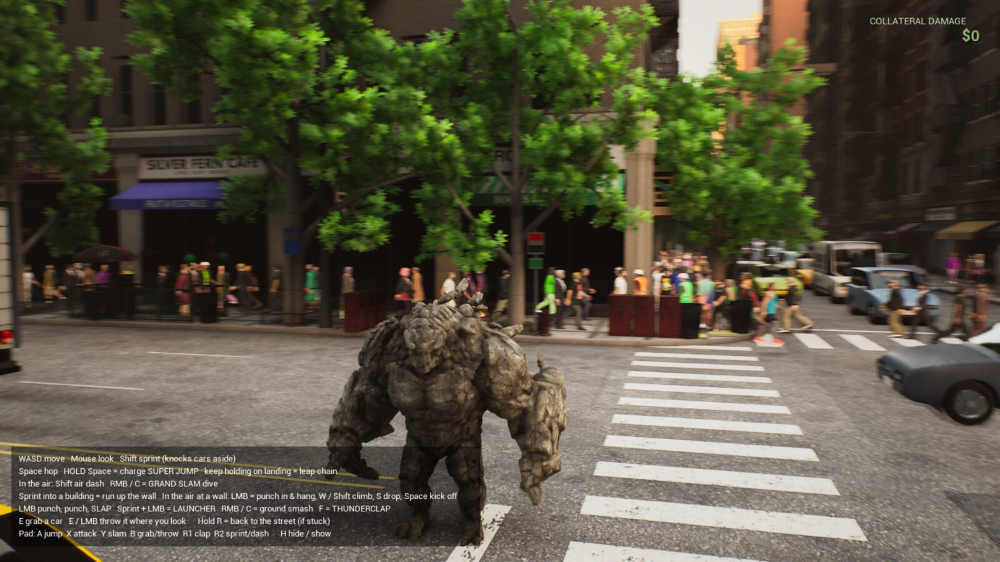
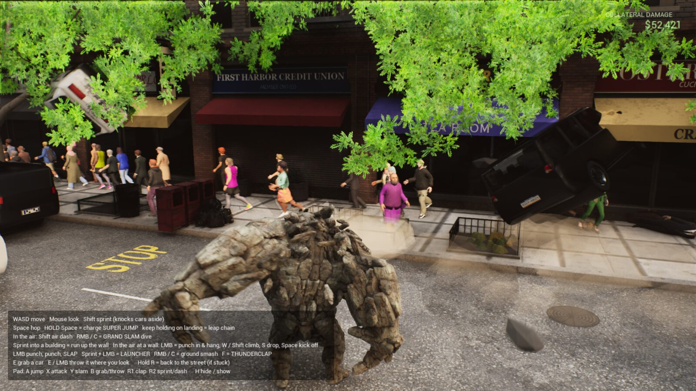
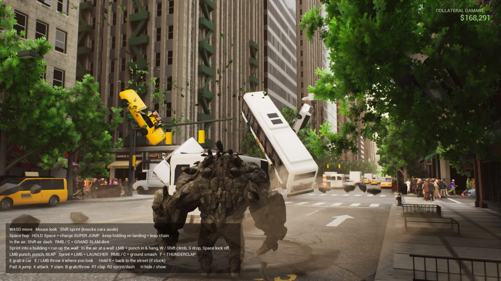
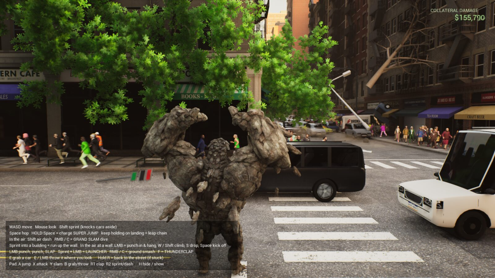
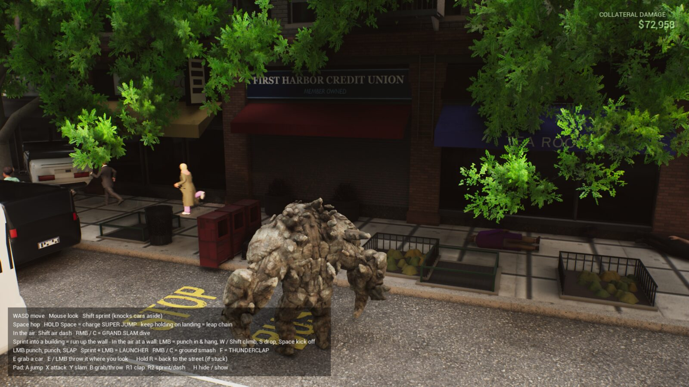
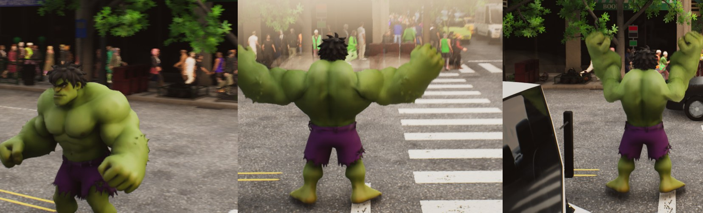
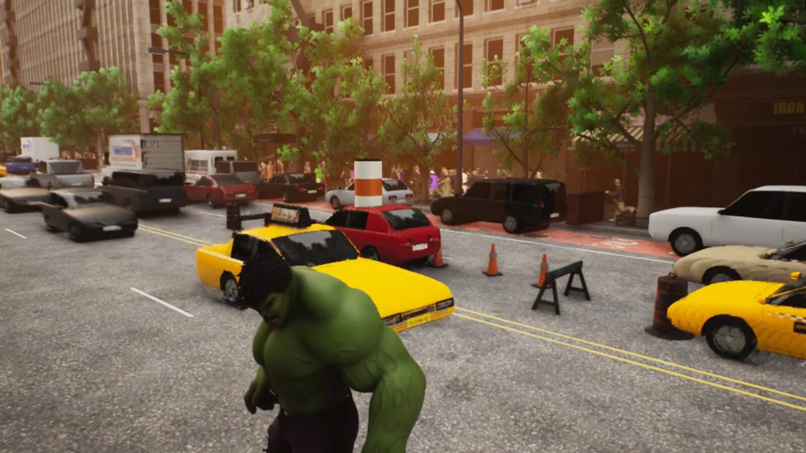
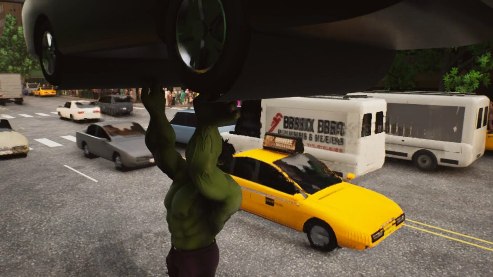

# Hulk in Manhattan

**An unofficial, non-commercial fan homage to *The Incredible Hulk: Ultimate Destruction* (2005), built with AI in Unreal Engine 5.8.** A huge rock-skinned brute runs, leaps and smashes his way across the whole island of Manhattan. Manhattan itself comes from our [Spider-Man 2 port](https://github.com/oh-ashen-one/spider-man-2), which started as Shikhar's [Spiderbench](https://github.com/xikhar/spiderbench).

> **Homage game, not an official Marvel game.** It is not affiliated with or endorsed by Marvel, Disney, Radical Entertainment, Vivendi, Activision, Sierra, Sony Interactive Entertainment, Insomniac Games or Epic Games. It is not for sale and never will be. See [DISCLAIMER.md](DISCLAIMER.md).

*In-game capture, October 31, 2026. The body is Epic's free Rampage character in its rock "Elemental" skin, driven by our own 17 animation clips.*

| | |
|---|---|
|  |  |
|  |  |

## What you can do

- **Move around the whole island.** Sprint fast enough to knock cars aside. Charge a super jump (about 40 m high and 100 m long) and chain leaps by holding jump as you land. Run straight up buildings, hang on with a punch, climb, and kick off.
- **Smash things.** Punch, punch and slap combos, a launcher uppercut, the thunderclap, a ground smash, and a grand slam dive from the air. Grab a car, carry it, and throw it wherever you look.
- **Watch the city react.** Traffic, crowds that run away, flying cars and a running **COLLATERAL DAMAGE** counter. You start in the Times Square plaza.

## How we got here

The whole game was built by AI agents ([Claude Code](https://claude.com/claude-code), mostly Claude Opus 5.5) under one person's direction. These captures come from the real game at each stage.

| Stage | What changed | Capture |
|---|---|---|
| **0. Where we started** | The finished Spider-Man 2 Unreal port: Spiderbench's city, now in Unreal, with a web-swinging hero. |  |
| **1. First brute (Oct 15)** | Replaced the hero with an AI-generated brute made of 11 rigid parts on a simple rig. Ugly, but walking around the real city. |  |
| **2. Skinned green body** | A properly skinned and textured green body with torn purple shorts and corrective shapes. |  |
| **3. The moveset** | Super jump with crater landings, wall run, leap chains, car grab and throw, thunderclap, grand slam, and crowds fleeing Times Square. |   |
| **4. Video-driven animation (Oct 29–31)** | Generated reference videos of each move, then fitted them to the rig with [video2rig](https://github.com/oh-ashen-one/video2rig). Blind A/B critiques chose which clips shipped: 2 Seedance, 8 MiniMax, 7 older clips. |   |
| **5. Professional body (Oct 31)** | Swapped our homemade mesh for Epic's free Rampage character (rock skin). We retargeted all 17 clips onto it and fixed a sideways, crooked run. |  |

**The hardest bug at the end:** on the new body the brute ran sideways, facing left and leaning. Every source clip has an 80° hip turn, and the two skeletons face different ways at rest (10° and 90°). The fix turns our hips in an editable retarget pose to match the target's rest facing *before* auto-alignment. [`tools/brute/retarget_paragon.py`](tools/brute/retarget_paragon.py) explains it step by step.

More detail: [design brief](docs/brute/BRIEF.md) · [first-night results](docs/brute/RESULTS.md) · [moveset](docs/brute/MOVESET.md) · [animation upgrade ledger](docs/brute/video2rig/LEDGER.md) · [asset ledger](docs/brute/ASSETS.md) · [rolling handoff](HANDOFF.md)

## Controls

| Action | Keyboard / mouse | Gamepad |
|---|---|---|
| Move / look | WASD / mouse | Sticks |
| Sprint (knocks cars aside) | Shift | R2 |
| Hop / **super jump** | Space / **hold** Space (keep holding on landing to chain leaps) | A |
| Air dash | Shift in the air | R2 |
| Punch, punch, slap | Left mouse | X |
| Launcher uppercut | Sprint + left mouse | |
| Ground smash / **grand slam** dive in the air | Right mouse or C | Y |
| **Thunderclap** | F | R1 |
| Grab a car / throw it where you look | E, then E or left mouse | B |
| Wall run | Sprint into a building | |
| On a wall | Left mouse to punch in and hang, W/Shift to climb, S to drop, Space to kick off | |
| Back to the street (if stuck) | Hold R | |
| Show / hide the controls card | H | |
| Settings menu / release mouse | Esc | |

## Run it

This repo is **source plus builders**. Generated Unreal content and the licensed Rampage pack are not in Git, so the first build takes work. An agent can do most of it (see the next section).

**You need:** a Mac with Apple silicon (built and tested on a Mac Studio M3 Ultra), Unreal Engine 5.8 installed from the Epic Games Launcher, Xcode, Python 3, Node.js 20.19+ and Blender 4.x for the character tools.

1. **Build the C++ module:** `unreal/WebHomage/Scripts/build_editor.sh`
2. **Build Manhattan:** `python3 unreal/WebHomage/Scripts/build_manhattan.py`. It exports the browser city and imports it into Unreal in stages. Some steps still have machine-specific input paths, so read [docs/UNREAL_PLAYTEST.md](docs/UNREAL_PLAYTEST.md) and fix the paths for your checkout.
3. **Build the brute:** `python3 unreal/WebHomage/Scripts/build_brute.py --fbx <brute_anim.fbx>`. This imports the green body and its 17 clips. The rigged source FBX is not published yet, so bring your own (see [BUILD_ON_THIS.md](docs/BUILD_ON_THIS.md#3-bring-your-own-character)).
4. **Optional: the rock body.** Add the free *Paragon: Rampage* pack from Fab into `Content/ParagonRampage`, then run [`tools/brute/retarget_paragon.py`](tools/brute/retarget_paragon.py) headless. On a Mac, the Epic launcher hides this Windows-only pack, so use the UE 5.8 editor's **Window → Fab → Add to Project** instead. Without the pack, the game falls back to the green body automatically.
5. **Play:** double-click `Play-Brute.command` for windowed 1920×1080 at a 60 fps cap. Append `-WHBruteSkin=Brute` for the green body, `-WHSpidey` for the old Spider-Man hero, or `/Game/Showcase/Maps/Manhattan_Island_Night` for night.

The browser version of the city from Spiderbench still runs with `npm ci && npm run dev`.

## Use this as the base for your own game

You can point your coding agent (Claude Code, Codex, Cursor and so on) at this repo and say:

> Read `AGENTS.md` and `docs/BUILD_ON_THIS.md` in this repo. I want to make **[your game idea]** on top of this Manhattan, with **[your character]** as the player. Check the licence section first and tell me what I need permission for. Then set up the build on my machine, swap in my character, and show me a capture.

[`AGENTS.md`](AGENTS.md) is the agent's map of the repo. [`docs/BUILD_ON_THIS.md`](docs/BUILD_ON_THIS.md) is the step-by-step recipe. It covers the build order, how to drop in any Unreal character (Fab, Mixamo or your own), the 17-clip animation contract, launch flags, the offscreen capture harness, and the problems we already solved.

**Licence first:** the city and the browser foundation are Shikhar's Spiderbench, released under a *view-only* licence. It allows reading and running the code locally. It does **not** allow using it in a distributed game without Shikhar's written permission. Prototyping and learning are fine. To ship something, ask the original author first. See [Credits and licence](#credits-and-licence).

## Credits and licence

**Original game: Spiderbench by Shikhar ([xikhar](https://github.com/xikhar)).** Spiderbench is a Claude-written browser web-swinging game made under Shikhar's direction. Its procedural Manhattan, traffic, pedestrians, traversal ideas and Three.js rendering pipeline are the foundation of everything here. Where it came from: [initial creation commit `9c223685`](https://github.com/oh-ashen-one/spider-man-2/commit/9c223685b5d3b6ddb2365e76284f193525c1f072), the [upstream update `4361e159`](https://github.com/xikhar/spiderbench/commit/4361e15951d98519ba515da3ec31d3e537cb4a10) (which credits Claude Opus 5.5 as a co-author), and the [original README](https://github.com/xikhar/spiderbench/blob/4361e15951d98519ba515da3ec31d3e537cb4a10/README.md). Thank you, Shikhar.

**Spider-Man 2 port: [oh-ashen-one/spider-man-2](https://github.com/oh-ashen-one/spider-man-2).** Our fork of Spiderbench added browser water and foliage, then ported the city, traversal, materials and characters to Unreal Engine 5.8. This repo started from its `main` at `0ca553f`. Its [project history](docs/PROJECT_HISTORY.md) lists every change with commit links.

**This repo** adds the brute: character, moveset, destruction, HUD, animation pipeline and the Rampage retarget.

**Characters and animation**
- **Rampage (Elemental skin)** by **Epic Games**, from the free *Paragon: Rampage* pack on [Fab](https://www.fab.com/), under the Fab Standard License: Unreal Engine use only, and the Paragon name may not appear in titles or ads. The pack is not redistributed here. Provenance is in [docs/brute/ASSETS.md](docs/brute/ASSETS.md).
- **The original green brute mesh**: generated with [Customuse](https://customuse.com/), then rigged, skinned and corrected by our Blender tools in [`tools/brute/`](tools/brute).
- **Animation sources**: Cartwheel text-to-motion (through Customuse), Meshy text-to-motion, reference videos generated with MiniMax H3 (through fal.ai) and ByteDance Seedance, and fits by [video2rig](https://github.com/oh-ashen-one/video2rig) (our fork of [canitcode/video2rig](https://github.com/canitcode/video2rig), AGPL-3.0). Every take and decision is in the [animation ledger](docs/brute/video2rig/LEDGER.md).

**Code and other third parties** (details in [THIRD_PARTY.md](THIRD_PARTY.md))
- **Daniel Greenheck**: [three-pinata](https://github.com/dgreenheck/three-pinata), [ez-tree](https://github.com/dgreenheck/ez-tree) and techniques from [tidewater](https://github.com/dgreenheck/tidewater) (DRG Software Solutions), MIT.
- **Evan Wallace**: [WebGL Water](https://madebyevan.com/webgl-water/) ripple and caustics ideas, MIT.
- **Music**: *Curious Groove*, supplied by the owner ([assets/audio/README.md](assets/audio/README.md)).
- **Engine**: Unreal Engine 5.8 by Epic Games.

**Built by AI agents.** Claude Opus 5.5 in Claude Code led the build, with Claude Sonnet, Haiku and Fable helpers, under Ashen's direction. Earlier Spider-Man 2 stages also used OpenAI and Kimi models; [PROJECT_HISTORY.md](docs/PROJECT_HISTORY.md) records which model did what.

**Licence.** The upstream code and assets remain under Shikhar's [Source-Available, View-Only License](LICENSE): personal, non-commercial viewing and local running only. No redistribution, and no use in any product, service or distributed game without written permission. Third-party components keep their own licences, and Hulk and all related names and likenesses belong to Marvel/Disney. Nothing here grants rights to any of them.

## About me

I'm **Ashen**, a vibe coder exploring what I can make with AI-assisted development. *Ultimate Destruction* is a game people have wanted remade for twenty years. This project tests how far a team of AI agents can get in Unreal Engine with one person choosing the direction, playing every build, and saying what feels wrong. AI did the building; whether it is fun to play is still my call.

- [GitHub: oh-ashen-one](https://github.com/oh-ashen-one)
- [Website: ashenoneport.com](https://ashenoneport.com)

More in [ABOUT_ME.md](ABOUT_ME.md). For bugs or ideas, please use [the issue tracker](https://github.com/oh-ashen-one/hulk/issues).
