# Brute — loop 1 results (2026-10-15, overnight)

Scope (owner, 2026-10-15): replace Spider-Man and web-swinging with a big green Brute that stomps, jumps and leaps; plus (owner
"go" message) **jumping, launching, hitting, slapping, thunderclap, picking cars up to throw them, HUGE jumps and grand slam**.
Built by Devin CLI (Claude Opus 5.5) on the Mac Studio M3 Ultra, branch `brute`.

All evidence below is from the real game (`-game`, offscreen, fixed timestep `-benchmark -fps=30`, 1280x720) through
`tools/brute/capture.sh`; numbers are from the per-frame telemetry CSV / `WH_BRUTE` log lines. Fixed-step captures are not
frame-rate evidence, and none of this is owner gameplay acceptance.

## Before

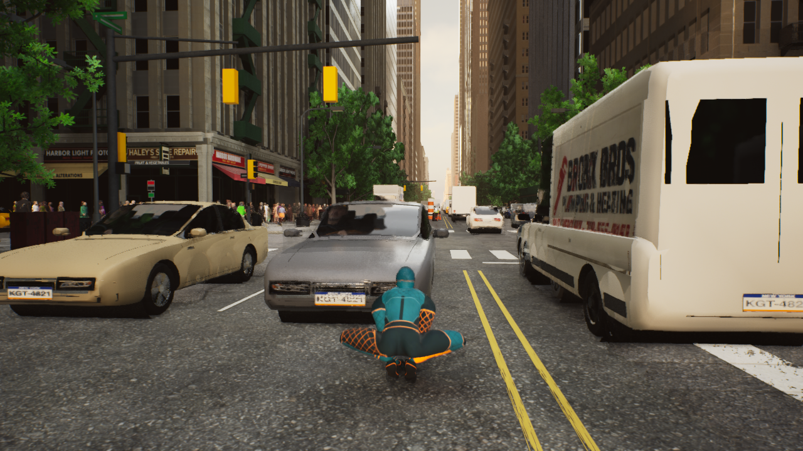 — the inherited Spider-Man hero in Manhattan (smoke run, same Content).

## Milestone 1 — Brute walks

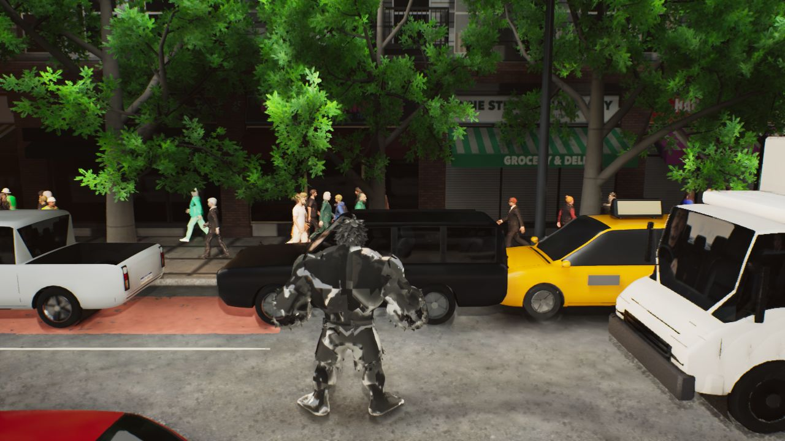

The Customuse-generated Brute (2.6 m, PBR textured, 11 rigid parts on a procedural rig) is the default pawn on every map that used
the swing hero (`AWebTravGameMode`; `-WHSpidey` restores the old hero). Existing city, traffic, crowd, lighting untouched.

## Milestone 2 — Brute moves (traversal cases)

| # | Case | Result (telemetry) | Still |
|---|---|---|---|
| 1 | idle -> run -> sprint (`m1_moveset`) | 27 m/s sprint; sprinting knocks cars aside | |
| 2 | full-charge super jump (`m1_moveset`) | apex 40.0 m, landed 96.6 m away | 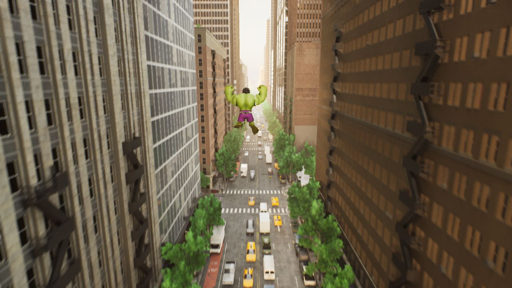 |
| 3 | crater landing (`m1_moveset`) | vz 44.9 m/s -> crater r 22 m, 9 cars thrown | 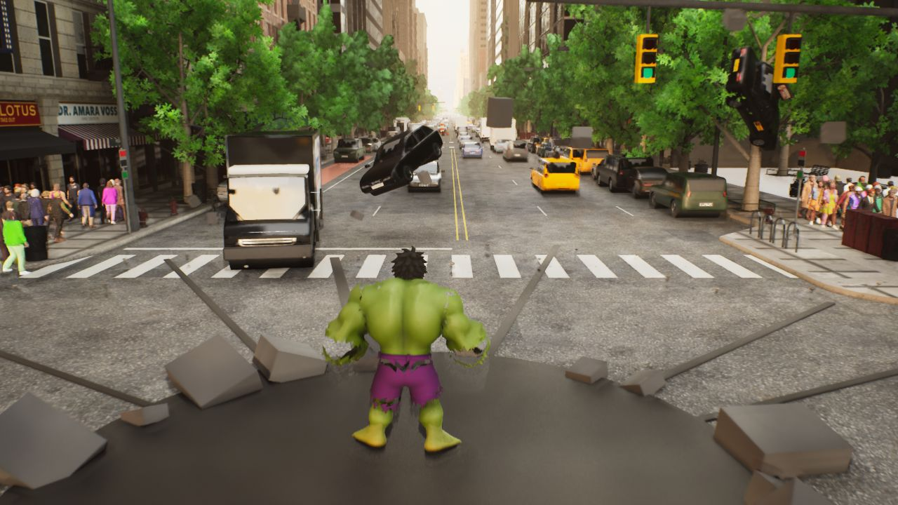 |
| 4 | running super jump (`m4_running_jump_slam`) | 46 m apex / 115 m range; air camera tilts to the landing | 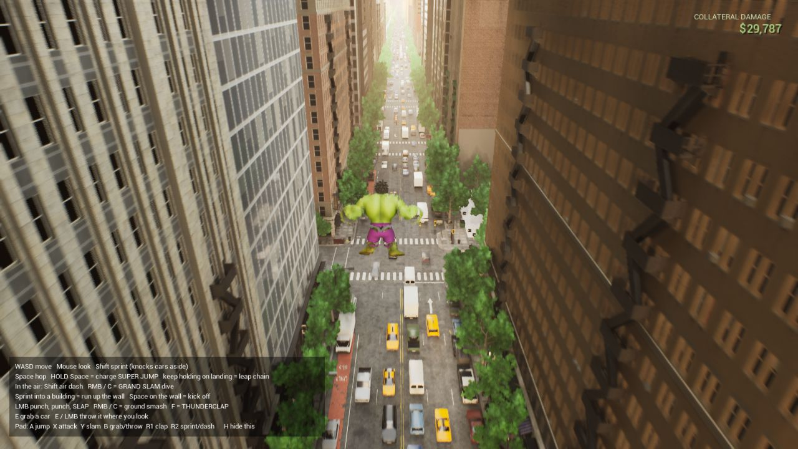 |
| 5 | air dash (`m4`) | 24 m/s burst at 41.7 m altitude | |
| 6 | grand slam dive (`m4`) | from 43.2 m at 60 m/s -> r 29 m, 14 cars | 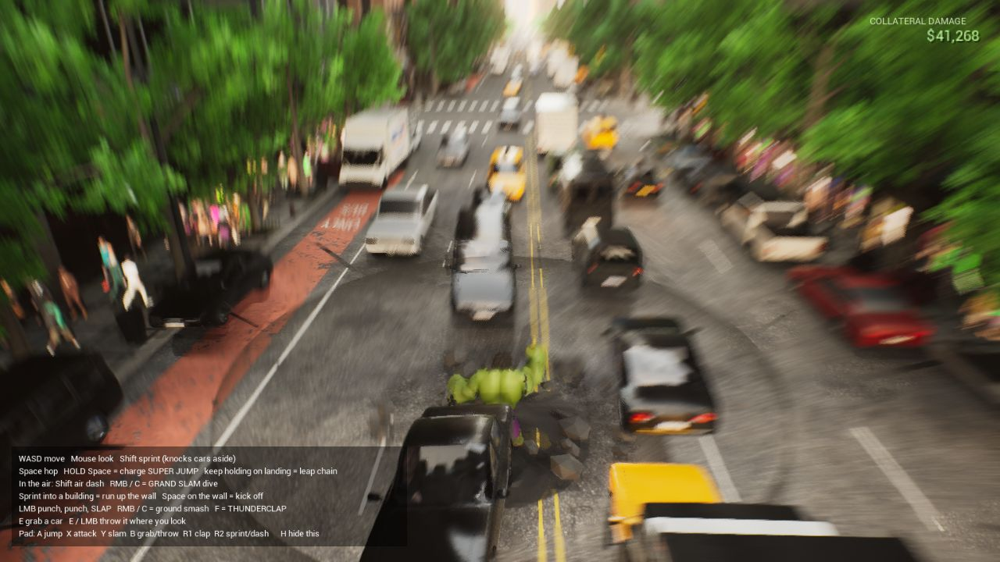 |
| 7 | wall run + top-out (`m3_wallrun`) | 24 m setback -> next face -> 73 m roof | 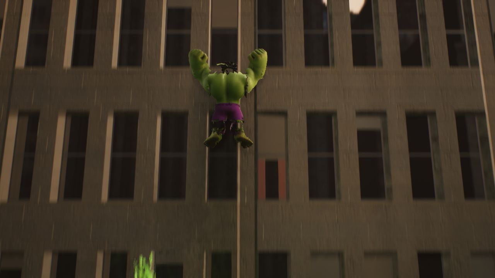 |
| 8 | wall kick + dash back (`m9_wall_kick`) | kick at 13.7 m, dash, re-catch, release, crater landing | |
| 9 | leap chain (`m8_leap_chain`) | 4 links, apex 40/44/48/52 m, 440 m down the avenue | 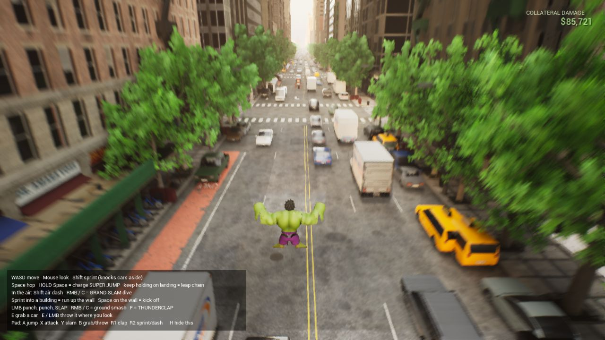 |
| 10 | whole-island map, Times Square (`m5_island_ts`) | running super jump 46 m in the owner's play map + profile | |

## Combat added in the same loop (owner request)

| Move | Result | Still |
|---|---|---|
| Punch, punch, SLAP combo (`m7_combat_cars`) | first punch launches a parked car | 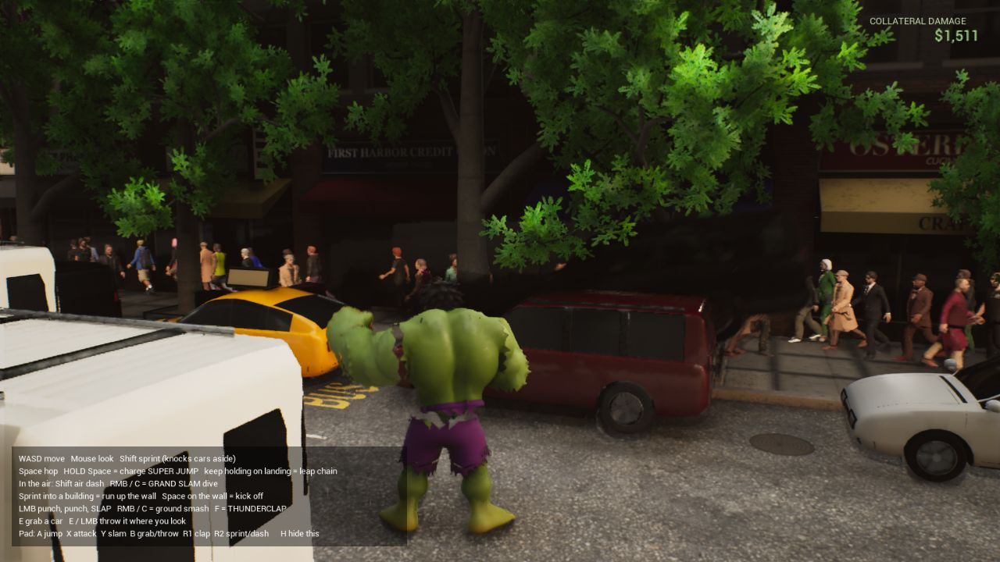 |
| Launcher uppercut, sprint + LMB (`m10_launcher`) | sprint-knocked car launched straight up, Brute pops up with it | 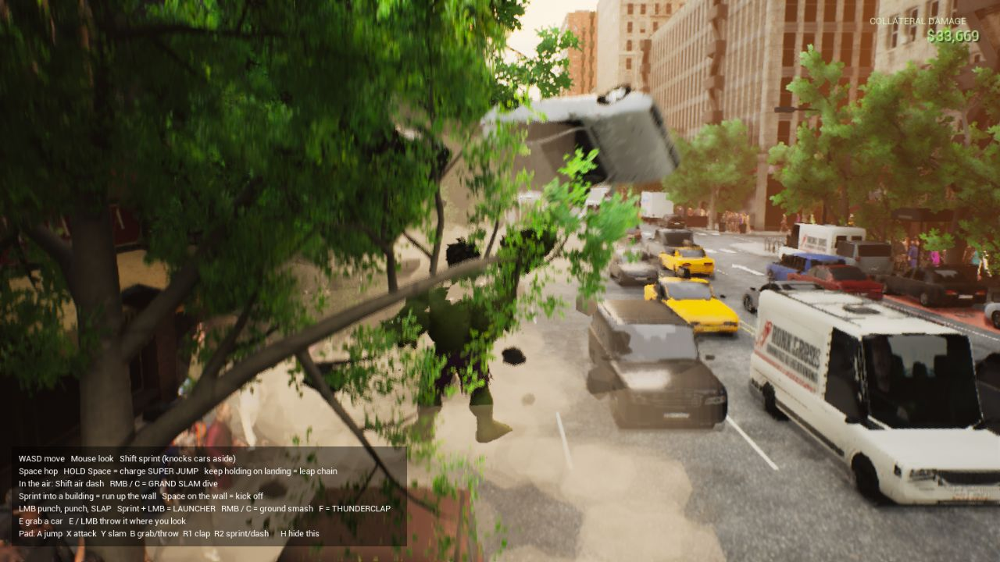 |
| Grab car overhead / throw (`m2_grab_throw`) | lifts a parked SUV, throws 58 m/s along the camera | 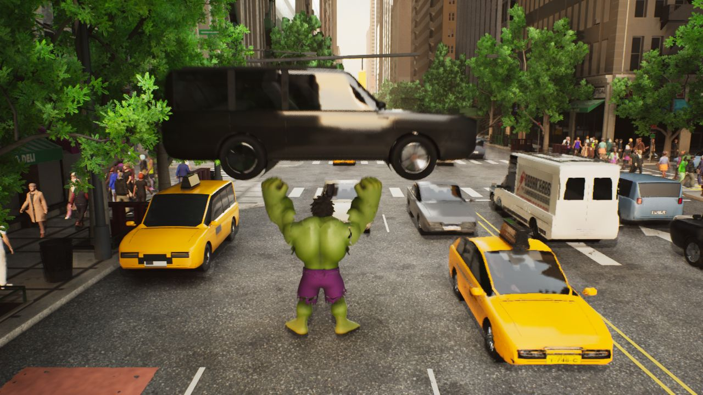 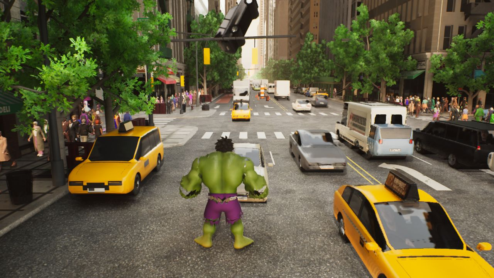 |
| Thunderclap (`m4`) | 8 cars blown down the avenue | 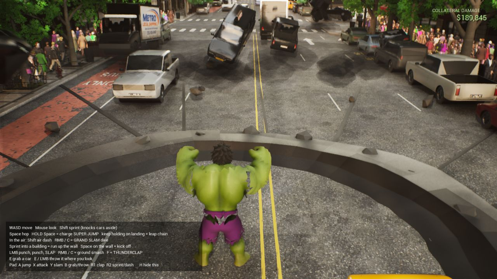 |
| Ground grand slam (`m1`, `m7`) | crater r 13 m in front, 5 cars | |
| Crowd reaction (`m6_ts_crowd`) | walkers knocked over near impacts, the rest run | 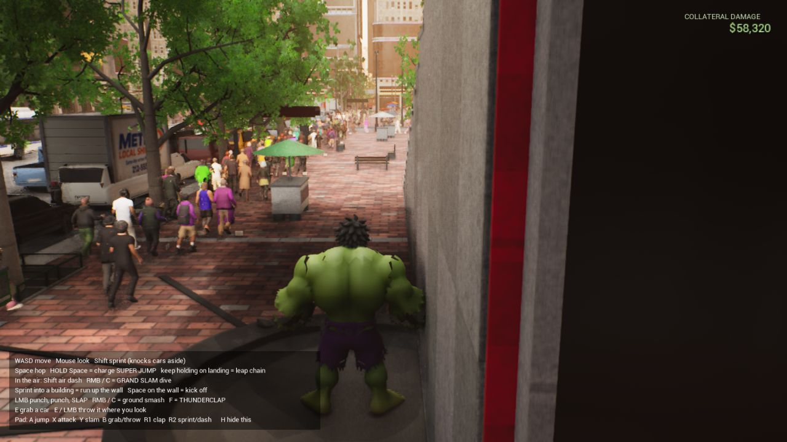 |

Stability: 44 s stress case chaining every move (`m11_stress`), no errors; day and night island maps checked.

HUD: collateral damage counter (top right), super-jump charge meter, controls card (first 25 s, H toggles).

## Self-review (NOT an independent critic pass)

The brief requires an independent critic per milestone. The owner was asleep and this session ran without subagents, so the
following is the builder's own review of the frames and must not be read as acceptance; an independent critic pass is the first
item of the next loop.

1. FIXED after the owner's first look: the rigid-part body tore at every joint. It is now one skinned mesh (no gaps); poses are
   still procedural (punch, slap, clap, overhead smash, carry, superhero landing) without secondary motion.
2. Impact FX are mesh-based (translucent rings, dust, rocks, flat crater + cracks); they read in daylight but are not Niagara-grade.
3. The camera can end up inside tree canopies or under awnings after landings; no occlusion fade.
4. Thunderclap shock band is faint against bright skies; the flying cars carry the read.
5. No enemies yet; perf not measured (needs a desktop-session launch).

## Reproduce

```bash
python3 unreal/WebHomage/Scripts/build_brute.py          # body + fx content (headless, GPU slot)
unreal/WebHomage/Scripts/build_editor.sh                 # C++
tools/brute/capture.sh m4_running_jump_slam -shots 3.6,5.0,6.4,8.6 -quit 10
./Play-Brute.command                                     # owner play (guarded launcher, windowed 1080p)
```
